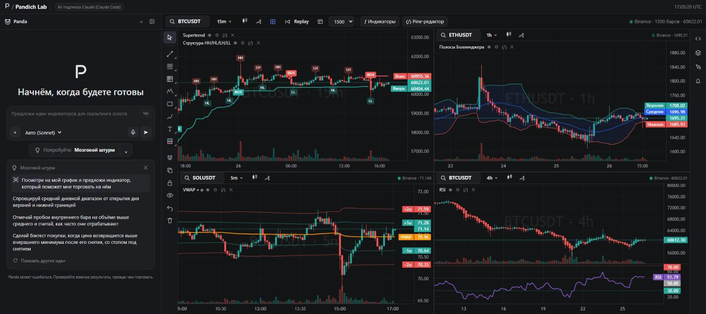
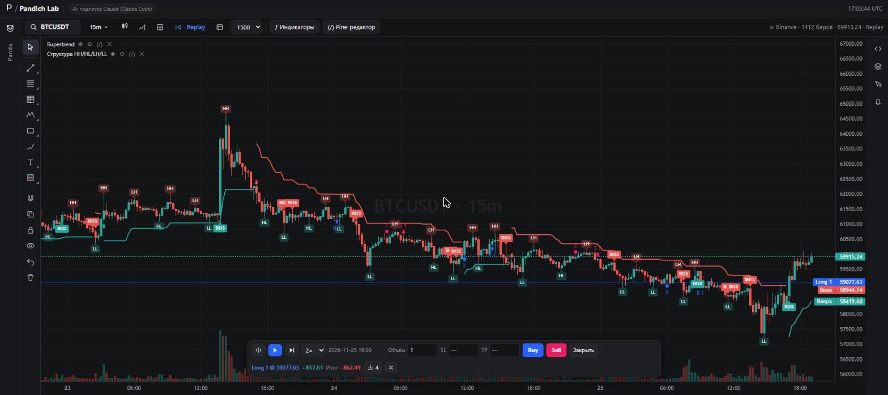

<div align="center">

# 🐼 Pandich Lab

**Describe an indicator in plain words — the AI writes Pine Script® v6, tests it and draws it on a live chart.**

Free · open source · runs locally on Windows and macOS

[](https://github.com/pandich93/pandich-lab/releases/latest)
[](LICENSE)


### [⬇ Windows](https://github.com/pandich93/pandich-lab/releases/latest/download/PandichLab-Setup.exe) &nbsp;·&nbsp; [⬇ macOS](https://github.com/pandich93/pandich-lab/releases/latest/download/PandichLab-mac.dmg)

[English](#english) · [Русский](#русский) · [O'zbekcha](#ozbekcha) · [Install with AI](#-install-with-an-ai-agent)



</div>

| Pine editor with live results | Bar Replay with paper trading |
|---|---|
|  |  |

## ⬇ Download

Click one link — the download starts immediately:

- **Windows 10/11:** [PandichLab-Setup.exe](https://github.com/pandich93/pandich-lab/releases/latest/download/PandichLab-Setup.exe) → double-click → done (no admin rights).
- **macOS 12+ (Apple Silicon & Intel):** [PandichLab-mac.dmg](https://github.com/pandich93/pandich-lab/releases/latest/download/PandichLab-mac.dmg) → drag *Pandich Lab* into Applications.

> The installers are not code-signed yet.
> - **Windows:** "Windows protected your PC" → **More info** → **Run anyway**.
> - **macOS:** System Settings → Privacy & Security → **Open Anyway**. The macOS build is new and less tested than Windows; please report problems in Issues.

On first launch a setup wizard installs Claude Code (for the AI assistant) and helps you sign in. The app updates itself. The interface is currently in Russian; the Panda assistant answers in the language you write in.

## 🤖 Install with an AI agent

Have an AI coding agent on your computer (Claude Code, Codex CLI, Gemini CLI, Cursor…)? Copy this prompt into it. It downloads the official release, verifies it, installs it and checks that it runs, asking you before each step. Details: [docs/AI_INSTALL.md](docs/AI_INSTALL.md).

```text
Install the open-source desktop app "Pandich Lab" on this computer for me.

Official source (use nothing else): https://github.com/pandich93/pandich-lab
Download only from that repository's GitHub Releases.

Rules
- Answer me in the language I write in.
- Ask for my confirmation before each step that downloads, installs or changes something. One step at a time.
- No administrator/sudo rights are needed. Do not use them and do not change any system or security settings
  except the single macOS step marked "ask first".
- Do not touch unrelated files. If a step fails, show me the exact error and stop; do not improvise workarounds.

Steps
1. Detect the OS and CPU architecture. Supported: Windows 10/11 x64, macOS 12+ (Apple Silicon or Intel).
   On anything else use the "From source" fallback at the end.
2. Read https://api.github.com/repos/pandich93/pandich-lab/releases/latest and pick the asset:
   Windows -> PandichLab-<version>-win-x64.exe ; macOS -> PandichLab-<version>-mac-universal.dmg
   (the same files are also attached as PandichLab-Setup.exe / PandichLab-mac.dmg; prefer the versioned names,
   their checksums are listed in latest.yml / latest-mac.yml)
   Tell me the version, file name, size and URL, then download it to my Downloads folder.
   Verify the download: the size must match the API, and the SHA-512 (base64) must match the value in the
   release asset latest.yml (Windows) or latest-mac.yml (macOS). If it does not match, delete the file and stop.
3. Install:
   - Windows: run the installer with the /S flag (silent, per-user). It installs to
     %LOCALAPPDATA%\Programs\pandich-lab-desktop and creates Desktop and Start-menu shortcuts.
   - macOS: mount the .dmg, copy "Pandich Lab.app" to /Applications, unmount.
     The app is not notarized by Apple yet, so macOS blocks the first launch. ASK FIRST, and only if I agree run:
       xattr -dr com.apple.quarantine "/Applications/Pandich Lab.app"
     If I decline, explain how to allow it manually: System Settings -> Privacy & Security -> "Open Anyway".
4. The built-in AI assistant (Panda) uses my own Claude Code. Check `claude --version`.
   If it is missing, ask me, then install it with Anthropic's official installer:
     Windows (PowerShell):  irm https://claude.ai/install.ps1 | iex
     macOS:                 curl -fsSL https://claude.ai/install.sh | bash
   Do NOT sign in for me and never ask for my password or tokens. Tell me to run `claude` once myself and sign in
   with my Claude account. Charts and indicators work without it.
5. Start Pandich Lab. Wait up to 60 seconds and check that the local server answers on one of
   http://127.0.0.1:3779/api/config ... http://127.0.0.1:3785/api/config (the app picks the first free port).
   If it does not, show me the end of the log:
     Windows: %APPDATA%\Pandich Lab\logs\server.log
     macOS:   ~/Library/Application Support/Pandich Lab/logs/server.log
6. Optional, Windows only, and only if I ask for MetaTrader 5 quotes: check for 64-bit Python 3 and run
   `python -m pip install --upgrade MetaTrader5`. The MT5 terminal must be running and logged in.
7. Finish with a short report: installed version, install location, whether Claude Code is ready,
   and what I still have to do myself (sign in to Claude; the app's first-run wizard repeats these checks).

From source (Linux, or if I prefer not to use the installer)
- Needs Node.js 18+ and git. Then:
    git clone https://github.com/pandich93/pandich-lab.git
    cd pandich-lab && npm install && npm start
  Open http://localhost:3777 . The server listens on 127.0.0.1 only; never expose it to a network.
```

---

## Русский

### Что это

Pandich Lab — приложение, которое работает у тебя на компьютере.

- Слева чат **Panda** (Claude), справа живой график.
- Ты описываешь индикатор словами. Panda пишет Pine Script v6, сам запускает его на текущем графике через [PineTS](https://www.npmjs.com/package/pinets), читает ошибки, исправляет и рисует результат.
- Готовый код можно сохранить и вставить в TradingView.

Возможности:

- **График:**
  - любые таймфреймы, включая нестандартные (22m, 90m, 2D);
  - 10 типов графика, логарифмическая и процентная шкалы;
  - поиск символа;
  - 35 инструментов рисования.
- **Мульти-график** до 8 окон с синхронизацией символа, интервала, перекрестия и времени.
- **Pine-редактор** (Monaco): подсветка, автодополнение, ошибки на строке, логи, тестер стратегий, история версий, diff.
- **Replay:** проигрывание истории бар за баром. Индикаторы на каждом шаге пересчитываются только по открытым барам. Есть бумажные сделки с SL/TP и карточка итогов: profit factor, просадка, кривая эквити, CSV.
- **Watch:** сервер сам отслеживает `alert()` и `alertcondition()` на закрытии бара и шлёт уведомление в Telegram или в браузер. Работает и при закрытой вкладке.
- **Библиотека:** 23 встроенных индикатора, шаблоны индикаторов, макеты экрана.
- **Данные:**
  - крипта с Binance через публичное зеркало;
  - по желанию свой счёт MetaTrader 5 (только Windows, только чтение котировок).

### Как работает ИИ

Panda работает через твой собственный Claude:

- **По умолчанию** через локальный [Claude Code](https://docs.claude.com/en/docs/claude-code/overview), вошедший в твою подписку Claude (Pro/Max). Запросы расходуют её лимиты.
- **Или** через твой API-ключ Anthropic: «⚙ Настройки» → карточка Claude → «Свой API-ключ». Ключ хранится только на твоём компьютере, оплата идёт по расходу токенов с твоего счёта Anthropic.
- Способ входа выбираешь ты сам; приложение не отключает ни один способ входа Claude Code.

Проект не включает и не раздаёт ничьих учётных данных: каждый пользователь подключает свои.

### Приложение для Windows и macOS

Скачать сразу: **Windows** — [PandichLab-Setup.exe](https://github.com/pandich93/pandich-lab/releases/latest/download/PandichLab-Setup.exe), **macOS** — [PandichLab-mac.dmg](https://github.com/pandich93/pandich-lab/releases/latest/download/PandichLab-mac.dmg). Все версии — в [Releases](../../releases):
- **Windows 10/11 (x64):** `PandichLab-x.y.z-win-x64.exe`. Двойной клик, и приложение установится без прав администратора.
- **macOS (Apple Silicon и Intel):** `PandichLab-x.y.z-mac-universal.dmg`. Перетащи приложение в «Программы».

При первом запуске откроется мастер с кнопкой **«Установить всё»**. Она сама скачает с официальных сайтов и поставит всё нужное, без прав администратора: на Windows — Claude Code, Git Bash и, по желанию, Python 3.13 с модулем MetaTrader5; на macOS — Claude Code. Затем откроется окно входа в Claude: войдите через подписку в браузере, мастер сам заметит, что вход выполнен. Приложение обновляется само.

> Установщики пока **не подписаны**:
> - **Windows** покажет «Windows защитила ваш компьютер» → «Подробнее» → «Выполнить в любом случае».
> - **macOS** заблокирует первый запуск → «Системные настройки» → «Конфиденциальность и безопасность» → «Всё равно открыть».

Собрать установщик самому: `desktop\build-win.bat` (Windows) или `desktop/build-mac.sh` (macOS).

**Установка через ИИ.** Если у тебя на компьютере есть ИИ-агент (Claude Code, Codex CLI, Gemini CLI, Cursor), скопируй в него [промпт из начала страницы](#-install-with-an-ai-agent): он сам скачает релиз, проверит его, установит и запустит, спрашивая разрешение перед каждым шагом.

Интерфейс пока на русском. Сборка для macOS новая и проверена меньше, чем для Windows.

### Установка из исходников

Нужно:
- [Node.js](https://nodejs.org) 18+;
- [Claude Code](https://docs.claude.com/en/docs/claude-code/overview): `npm install -g @anthropic-ai/claude-code`, затем один раз запустить `claude` и войти.

Без Claude Code график тоже работает, недоступен только чат.

**Windows:**
1. Распакуй архив и запусти `start.bat`. Он поставит зависимости и откроет http://localhost:3777.
2. Для котировок MetaTrader 5 (необязательно) нужны 64-битный Python 3 и запущенный терминал MT5. `start.bat` сам поставит пакет `MetaTrader5`.
3. Claude Code на Windows нужен Git for Windows (Git Bash).

**macOS / Linux:**
```bash
./start.sh
```
Или вручную: `npm install && npm start`. MT5 здесь недоступен (пакет `MetaTrader5` только для Windows), работают данные Binance.

### Настройка

Скопируй `config.example.json` в `config.json` и измени нужное. Поля в `server.mjs` → `CFG`:
- `backend`: `claude-code` или `api`;
- `model`;
- `claudeBin`;
- `anthropicApiKey` (для `backend: api`);
- `python`, `mt5Path`, `mt5Enabled`.

Переменные окружения:

| Переменная | Назначение |
|---|---|
| `PORT` | порт сервера, по умолчанию 3777 |
| `QL_PYTHON` | команда Python для моста MT5 |
| `MT5_PATH` | путь к `terminal64.exe`, если терминалов несколько |
| `MT5=0` | отключить MT5 |
| `MOCK=1` | синтетические данные для разработки |

Личные данные хранятся только у тебя и в git не попадают (`.gitignore`):
- `data/`: сигналы Watch, настройки Telegram, шаблоны, макеты;
- `scripts/`: сохранённые скрипты.

### Если что-то не подключается

Нажмите **⚙ Настройки** в правом верхнем углу. Там видно состояние Claude Code (Panda), MetaTrader 5, Binance, интернета и Telegram. Для каждой проблемы написано, что сделать, и есть кнопки: «Проверить Panda», «Войти в Claude», «Установить Claude Code», «Переподключить MT5», «Установить модуль». Точка на кнопке настроек показывает общее состояние: зелёная — всё в порядке, жёлтая — предупреждение, красная — проблема.

Не получается — нажмите **«Скопировать диагностику»** и пришлите текст в [Issues](https://github.com/pandich93/pandich-lab/issues). Путь к домашней папке, имя пользователя, токены и номер счёта в отчёте скрываются.

### Безопасность

- Сервер слушает только `127.0.0.1`. **Не открывай его в сеть и не выставляй в интернет:** в нём нет авторизации.
- Panda запускается в Claude Code с разрешением читать и писать файлы в папке `agent/` и выполнять `node ql.mjs …`, без подтверждения каждого шага (`--permission-mode dontAsk`). Pine-код выполняется в процессе сервера.
- Запускай только код, которому доверяешь.

### Отказ от ответственности

Это инструмент для исследования и обучения, а **не инвестиционная рекомендация**. Индикаторы, сигналы, Replay и бэктесты могут ошибаться. Торговля на финансовых рынках связана с риском потери средств. Авторы не несут ответственности за твои торговые решения.

---

## English

### What it is

Pandich Lab is a local app.

- On the left, an AI chat called **Panda** (Claude); on the right, a live chart.
- You describe an indicator in plain words. Panda writes Pine Script v6, runs it on the current chart through [PineTS](https://www.npmjs.com/package/pinets), reads the errors, fixes them and draws the result.
- You can save the code and paste it into TradingView.

Features:

- **Chart:**
  - any timeframe, including custom ones (22m, 90m, 2D);
  - 10 chart types, log and percent scales;
  - symbol search;
  - 35 drawing tools.
- **Multi-chart** with up to 8 panes, synced symbol, interval, crosshair and time.
- **Pine editor** (Monaco): highlighting, completion, inline errors, logs, strategy tester, version history, diff.
- **Bar Replay:** scripts re-run on revealed bars only, so they can't see the future. Paper trading with SL/TP and a results card: profit factor, drawdown, equity curve, CSV.
- **Watch mode:** the server evaluates `alert()` and `alertcondition()` on every closed bar and notifies Telegram or the browser, even with the tab closed.
- **Library:** 23 built-in indicators, indicator templates, saved screen layouts.
- **Data:**
  - crypto from Binance via its public data mirror;
  - optionally your own MetaTrader 5 account (Windows only, read-only quotes).

### How the AI works

Panda runs on **your own** Claude:

- **By default** through a local [Claude Code](https://docs.claude.com/en/docs/claude-code/overview) signed in to your Claude subscription. Usage counts against that plan's limits.
- **Or** with your own Anthropic API key: «⚙ Настройки» (Settings) → Claude card → «Свой API-ключ». The key stays on your computer; usage is billed to your Anthropic account.
- You choose the sign-in method; the app does not disable any of Claude Code's sign-in methods.

The project ships no credentials; every user brings their own.

### Desktop app (Windows & macOS)

Installers are in [Releases](../../releases):
- **Windows 10/11 (x64):** `PandichLab-x.y.z-win-x64.exe`, a one-click install without admin rights.
- **macOS (Apple Silicon & Intel):** `PandichLab-x.y.z-mac-universal.dmg`.

On first launch the setup wizard offers one **«Установить всё»** (install everything) button. It downloads everything from the official sites and installs it without admin rights: Claude Code, Git Bash and, optionally, Python 3.13 with the MetaTrader5 module on Windows; Claude Code on macOS. Then it opens the Claude sign-in and notices when you are signed in. The app updates itself.

> The installers are **not code-signed** yet:
> - **Windows SmartScreen:** "More info" → "Run anyway".
> - **macOS:** System Settings → Privacy & Security → "Open Anyway".

Build it yourself: `desktop\build-win.bat` or `desktop/build-mac.sh`.

### Install from source

Requirements:
- [Node.js](https://nodejs.org) 18+;
- [Claude Code](https://docs.claude.com/en/docs/claude-code/overview): `npm install -g @anthropic-ai/claude-code`, then run `claude` once and sign in.

The chart works without Claude Code; only the chat needs it.

- **Windows:** run `start.bat`. MetaTrader 5 quotes need 64-bit Python 3 and a running MT5 terminal; `start.bat` installs the `MetaTrader5` package.
- **macOS / Linux:** run `./start.sh`, or `npm install && npm start`. Binance data only.

### Configuration

Copy `config.example.json` to `config.json`.

| Env var | Purpose |
|---|---|
| `PORT` | server port, default 3777 |
| `QL_PYTHON` | Python command for the MT5 bridge |
| `MT5_PATH` | path to `terminal64.exe` if you have several terminals |
| `MT5=0` | disable MT5 |
| `MOCK=1` | synthetic data for development |

Your data stays in `data/` and `scripts/`, both git-ignored.

### Troubleshooting connections

Click **⚙ Настройки** (Settings) in the top-right corner. It shows the status of Claude Code (Panda), MetaTrader 5, Binance, the internet and Telegram. Each problem comes with a plain-language fix and one-click actions: test Panda, sign in to Claude, install Claude Code, reconnect MT5, install the Python module. The dot on the Settings button shows the overall state: green means all good, yellow a warning, red a problem.

Still stuck? Click **«Скопировать диагностику»** (copy diagnostics) and paste the report into an [Issue](https://github.com/pandich93/pandich-lab/issues). The home path, user name, tokens and account number are masked in the report.

### Security

- The server binds to `127.0.0.1` and has no authentication. **Never expose it to a network.**
- Panda runs inside Claude Code with permission to edit files in `agent/` and run `node ql.mjs …` without step-by-step confirmation. Pine code executes inside the server process.

### Disclaimer

For research and education only. **Not financial advice.** Indicators, signals, replays and backtests can be wrong. Trading involves risk of loss.

---

## O'zbekcha

### Bu nima

Pandich Lab — kompyuteringizda ishlaydigan dastur: o'ngda jonli grafik, chapda **Panda** ismli AI yordamchi.

- Indikatorni oddiy so'z bilan tasvirlaysiz. Panda Pine Script v6 kodini yozadi, grafikda ishga tushiradi, xatolarni tuzatadi va natijani chizadi.
- Tayyor kodni saqlab, TradingView'ga qo'yishingiz mumkin.

Imkoniyatlar:

- **Grafik:** istalgan taymfreym (22m, 90m, 2D ham), 10 xil grafik turi, 35 ta chizish asbobi.
- **Multi-grafik:** bir ekranda 8 tagacha grafik, sinxronlashtirish bilan.
- **Pine-muharrir:** kod yozish, xatolar, loglar, strategiya testeri, versiyalar tarixi.
- **Replay:** tarixni sham-shamlab qayta o'ynatish va qog'ozda savdo qilish. Natijalar: profit factor, drawdown, equity egri chizig'i.
- **Watch:** signal har bir yopilgan shamda tekshiriladi va Telegram'ga yuboriladi, oyna yopiq bo'lsa ham.
- **Kutubxona:** 23 ta tayyor indikator, shablonlar, ekran maketlari.
- **Ma'lumotlar:** Binance (kripto) va, xohlasangiz, o'z MetaTrader 5 hisobingiz (faqat Windows).

### O'rnatish

1. Faylni yuklab oling: **Windows** — [PandichLab-Setup.exe](https://github.com/pandich93/pandich-lab/releases/latest/download/PandichLab-Setup.exe), **macOS** — [PandichLab-mac.dmg](https://github.com/pandich93/pandich-lab/releases/latest/download/PandichLab-mac.dmg).
2. Ishga tushiring.
   - **Windows** ogohlantirsa: **Подробнее / More info** → **Выполнить в любом случае / Run anyway**.
   - **macOS** bloklasa: System Settings → Privacy & Security → **Open Anyway**.
3. Birinchi ishga tushirishda **«Установить всё»** tugmasini bosing: dastur kerakli hamma narsani o'zi o'rnatadi (Windows: Claude Code, Git Bash, xohlasangiz Python + MetaTrader5; Mac: Claude Code). Keyin brauzerda Claude akkauntingizga kiring — tamom.

Yoki AI-agentingiz bo'lsa, [yuqoridagi promptni](#-install-with-an-ai-agent) unga nusxalang — o'zi o'rnatib beradi.

### AI qanday ishlaydi

Panda sizning o'z **Claude** obunangiz (Pro/Max) orqali, kompyuteringizdagi Claude Code yordamida ishlaydi. Grafik va indikatorlar obunasiz ham ishlaydi. Dastur interfeysi hozircha rus tilida.

### Ulanish bilan muammo bo'lsa

O'ng yuqoridagi **⚙ Настройки** tugmasini bosing: Claude Code (Panda), MetaTrader 5, Binance, internet va Telegram holati ko'rinadi. Har bir muammo uchun nima qilish kerakligi yozilgan va tuzatish tugmalari bor. Hal bo'lmasa, **«Скопировать диагностику»** tugmasini bosib, matnni dasturchiga yuboring.

### Ogohlantirish

Bu o'rganish va tahlil uchun vosita, **investitsiya maslahati emas**. Moliyaviy bozorlarda savdo qilish pul yo'qotish xavfi bilan bog'liq.

---

## License

Pandich Lab is licensed under the **GNU Affero General Public License v3.0 only**; see [LICENSE](LICENSE).
Third-party components and attributions are listed in [NOTICE](NOTICE). Charts are powered by TradingView Lightweight Charts™ (https://www.tradingview.com/).

Pandich Lab is an independent project. It is not affiliated with or endorsed by TradingView, Anthropic or MetaQuotes. Pine Script® is a trademark of TradingView, Inc. Claude and Claude Code are trademarks of Anthropic, PBC. MetaTrader is a trademark of MetaQuotes Ltd.
