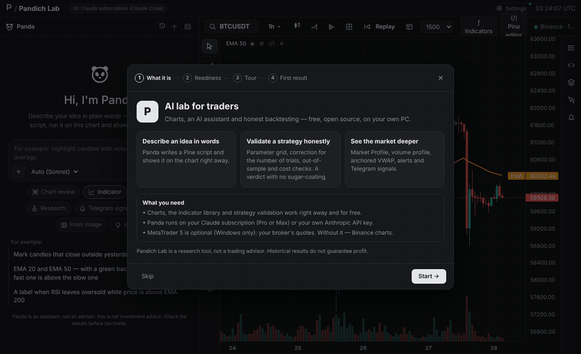
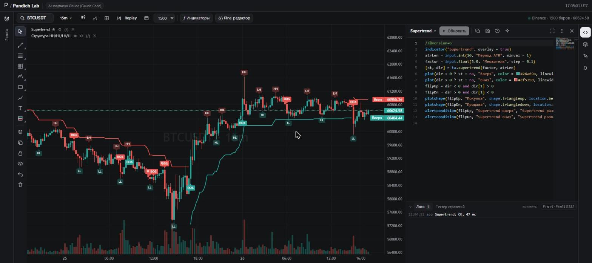

<div align="center">

# 🐼 Pandich Lab

### An AI lab for traders

Describe a strategy in plain words — the AI writes Pine Script® v6, draws it on a live chart<br>and an honest validator tells you whether it has a real edge. Free, open source, runs on your own PC.

[](https://github.com/pandich93/pandich-lab/releases/latest)
[](https://github.com/pandich93/pandich-lab/stargazers)
[](LICENSE)


### [⬇ Download for Windows](https://github.com/pandich93/pandich-lab/releases/latest/download/PandichLab-Setup.exe) &nbsp;·&nbsp; [⬇ Download for macOS](https://github.com/pandich93/pandich-lab/releases/latest/download/PandichLab-mac.dmg)

**English** · [Русский](README.ru.md) · [O'zbekcha](README.uz.md)



<sub>First-run tour and an honest check of the example strategy on real BTCUSDT 1h data from Binance. Its verdict: no significant edge.</sub>

</div>

## Why Pandich Lab

- **From idea to chart in one message.** Tell Panda (Claude) what you want; it writes Pine Script v6, runs it on your chart, reads its own errors and fixes them. The code pastes straight into TradingView.
- **Backtests that don't lie to you.** Many "profitable" strategies are just curve-fitted. Pandich Lab looks for a stable region of parameters instead of the best cell, corrects for the number of trials (deflated Sharpe), checks out-of-sample (walk-forward), runs Monte Carlo and charges the broker's real per-bar spread. You get a plain verdict before you risk money.
- **A real charting workstation.** Custom timeframes, 38 drawing tools, Market Profile, volume profile, anchored VWAP, multi-chart, Bar Replay with paper trading, alerts to Telegram.
- **Local and open.** Runs on your machine; your scripts and data never leave it. AGPL-3.0.

⭐ **If Pandich Lab is useful to you, star the repo** — it helps other traders find it.

## What you need

| | Free, right away | Bring your own |
|---|---|---|
| Charts, drawing tools, Market Profile, volume profile, VWAP | ✅ | — |
| Indicator library, Pine editor, strategy tester, **honest validation** | ✅ | — |
| The **Panda** AI chat (writes indicators and strategies) | — | a Claude Pro/Max subscription or an Anthropic API key |
| Your broker's quotes | — | MetaTrader 5, Windows only (otherwise Binance) |

Windows 10/11 (x64) or macOS 12+. No admin rights needed.

| Pine editor with live results | Bar Replay with paper trading |
|---|---|
|  |  |

## Install in 3 steps

1. **Download:** [Windows — PandichLab-Setup.exe](https://github.com/pandich93/pandich-lab/releases/latest/download/PandichLab-Setup.exe) · [macOS — PandichLab-mac.dmg](https://github.com/pandich93/pandich-lab/releases/latest/download/PandichLab-mac.dmg) (Apple Silicon & Intel).
2. **Run it.** The installers are not code-signed yet:
   - **Windows:** "Windows protected your PC" → **More info** → **Run anyway**.
   - **macOS:** drag *Pandich Lab* into Applications; if macOS blocks it → System Settings → Privacy & Security → **Open Anyway**. The macOS build is newer and less tested than Windows.
3. **Click "Install everything"** in the first-run wizard. It installs Claude Code (plus Git Bash and, optionally, Python + MetaTrader5 on Windows) from the official sites and opens the Claude sign-in. Then a short tour shows you around and lets you validate an example strategy in one click.

The app updates itself. Interface: English, Русский, O'zbekcha. All versions are in [Releases](../../releases).

## 🤖 Install with an AI agent

Have an AI coding agent on your computer (Claude Code, Codex CLI, Gemini CLI, Cursor…)? Copy this prompt into it. It downloads the official release, verifies it, installs it and checks that it runs, asking you before each step. Details: [docs/AI_INSTALL.md](docs/AI_INSTALL.md).

```text
Install the open-source desktop app "Pandich Lab" on this computer for me.

Official source (use nothing else): https://github.com/pandich93/pandich-lab
Download only from that repository's GitHub Releases.

Rules
- Answer me in the language I write in.
- Ask for my confirmation before each step that downloads, installs or changes something. One step at a time.
- No administrator/sudo rights are needed. Do not use them and do not change any system or security settings
  except the single macOS step marked "ask first".
- Do not touch unrelated files. If a step fails, show me the exact error and stop; do not improvise workarounds.

Steps
1. Detect the OS and CPU architecture. Supported: Windows 10/11 x64, macOS 12+ (Apple Silicon or Intel).
   On anything else use the "From source" fallback at the end.
2. Read https://api.github.com/repos/pandich93/pandich-lab/releases/latest and pick the asset:
   Windows -> PandichLab-<version>-win-x64.exe ; macOS -> PandichLab-<version>-mac-universal.dmg
   (the same files are also attached as PandichLab-Setup.exe / PandichLab-mac.dmg; prefer the versioned names,
   their checksums are listed in latest.yml / latest-mac.yml)
   Tell me the version, file name, size and URL, then download it to my Downloads folder.
   Verify the download: the size must match the API, and the SHA-512 (base64) must match the value in the
   release asset latest.yml (Windows) or latest-mac.yml (macOS). If it does not match, delete the file and stop.
3. Install:
   - Windows: run the installer with the /S flag (silent, per-user). It installs to
     %LOCALAPPDATA%\Programs\pandich-lab-desktop and creates Desktop and Start-menu shortcuts.
   - macOS: mount the .dmg, copy "Pandich Lab.app" to /Applications, unmount.
     The app is not notarized by Apple yet, so macOS blocks the first launch. ASK FIRST, and only if I agree run:
       xattr -dr com.apple.quarantine "/Applications/Pandich Lab.app"
     If I decline, explain how to allow it manually: System Settings -> Privacy & Security -> "Open Anyway".
4. The built-in AI assistant (Panda) uses my own Claude Code. Check `claude --version`.
   If it is missing, ask me, then install it with Anthropic's official installer:
     Windows (PowerShell):  irm https://claude.ai/install.ps1 | iex
     macOS:                 curl -fsSL https://claude.ai/install.sh | bash
   Do NOT sign in for me and never ask for my password or tokens. Tell me to run `claude` once myself and sign in
   with my Claude account. Charts and indicators work without it.
5. Start Pandich Lab. Wait up to 60 seconds and check that the local server answers on one of
   http://127.0.0.1:3779/api/config ... http://127.0.0.1:3785/api/config (the app picks the first free port).
   If it does not, show me the end of the log:
     Windows: %APPDATA%\Pandich Lab\logs\server.log
     macOS:   ~/Library/Application Support/Pandich Lab/logs/server.log
6. Optional, Windows only, and only if I ask for MetaTrader 5 quotes: check for 64-bit Python 3 and run
   `python -m pip install --upgrade MetaTrader5`. The MT5 terminal must be running and logged in.
7. Finish with a short report: installed version, install location, whether Claude Code is ready,
   and what I still have to do myself (sign in to Claude; the app's first-run wizard repeats these checks).

From source (Linux, or if I prefer not to use the installer)
- Needs Node.js 18+ and git. Then:
    git clone https://github.com/pandich93/pandich-lab.git
    cd pandich-lab && npm install && npm start
  Open http://localhost:3777 . The server listens on 127.0.0.1 only; never expose it to a network.
```

## Features

Pandich Lab is a local app: an AI chat called **Panda** (Claude) on the left, a live chart on the right.

- **Describe an idea in plain words.** Panda writes Pine Script v6, runs it on the current chart through [PineTS](https://www.npmjs.com/package/pinets), reads the errors, fixes them and draws the result. You can paste the code into TradingView.
- **Validate a strategy honestly before risking money.** Not "the best parameters" but the stable region of the grid and its average; a correction for the number of trials (deflated Sharpe); out-of-sample walk-forward; Monte Carlo; the broker's per-bar spread and slippage. The result is a plain verdict: "no significant edge", "needs more checks" or "forward-test on demo".
- **Research mode.** Ask Panda to test several ideas in a row — each goes through the same honest check and the results are collected in one summary.

Features:

- **Chart:**
  - any timeframe, including custom ones (22m, 90m, 2D);
  - 10 chart types, log and percent scales;
  - 38 drawing tools, including volume profile (range and anchored) and anchored VWAP;
  - Market Profile (TPO): POC, value area, initial balance, naked POCs.
- **Multi-chart** with up to 8 panes, synced symbol, interval, crosshair and time.
- **Pine editor** (Monaco): highlighting, completion, inline errors, logs, strategy tester, version history, diff.
- **Bar Replay:** scripts re-run on revealed bars only, so they can't see the future. Paper trading with SL/TP and a results card: profit factor, drawdown, equity curve, CSV.
- **Watchlist & alerts:** quotes and price alerts on a level cross (a line on the chart, a notification and Telegram).
- **Watch mode:** the server evaluates `alert()` and `alertcondition()` on every closed bar and notifies Telegram or the browser, even with the tab closed.
- **History:** every Panda chat and validation report is saved — search, continue a chat, export to Markdown.
- **Library:** 23 built-in indicators and strategies, indicator templates, saved screen layouts.
- **Data:**
  - crypto from Binance via its public data mirror;
  - optionally your own MetaTrader 5 account (Windows only, read-only quotes).

## How the AI works

Panda runs on **your own** Claude:

- **By default** through a local [Claude Code](https://docs.claude.com/en/docs/claude-code/overview) signed in to your Claude subscription. Usage counts against that plan's limits.
- **Or** with your own Anthropic API key: **⚙ Settings** → Claude card → **Own API key**. The key stays on your computer; usage is billed to your Anthropic account.
- You choose the sign-in method; the app does not disable any of Claude Code's sign-in methods.

The project ships no credentials; every user brings their own.

## FAQ

- **Is it free?** Yes: charts, the library, the tester and honest strategy validation are free and need no account. The only paid part is your own Claude for the Panda chat (a Pro/Max subscription or an API key). Pandich Lab charges nothing for it and never sees your account.
- **Is it a trading bot?** No. It never places orders and does not trade on your account — MetaTrader 5 is used for reading quotes only.
- **The check says "no significant edge". Is that a bug?** Most likely not: that's how most social-media strategies end. That's the point — learn it on history, not on your deposit.
- **Can I use it without Claude?** Yes, everything except the chat.

## Install from source

Requirements:
- [Node.js](https://nodejs.org) 18+;
- [Claude Code](https://docs.claude.com/en/docs/claude-code/overview): `npm install -g @anthropic-ai/claude-code`, then run `claude` once and sign in.

The chart works without Claude Code; only the chat needs it.

- **Windows:** run `start.bat`. MetaTrader 5 quotes need 64-bit Python 3 and a running MT5 terminal; `start.bat` installs the `MetaTrader5` package.
- **macOS / Linux:** run `./start.sh`, or `npm install && npm start`. Binance data only.

Build the installer yourself: `desktop\build-win.bat` (Windows) or `desktop/build-mac.sh` (macOS).

## Configuration

Copy `config.example.json` to `config.json`.

| Env var | Purpose |
|---|---|
| `PORT` | server port, default 3777 |
| `QL_PYTHON` | Python command for the MT5 bridge |
| `MT5_PATH` | path to `terminal64.exe` if you have several terminals |
| `MT5=0` | disable MT5 |
| `MOCK=1` | synthetic data for development |

Your data stays in `data/` and `scripts/`, both git-ignored.

## Interface language

Russian, Uzbek (O'zbekcha) and English. Pick it in the first-run wizard or in **⚙ Settings** → **App**. Panda replies in the interface language.

## Troubleshooting connections

Click **⚙ Settings** in the top-right corner. It shows the status of Claude Code (Panda), MetaTrader 5, Binance, the internet and Telegram. Each problem comes with a plain-language fix and one-click actions: test Panda, sign in to Claude, install Claude Code, reconnect MT5, install the Python module. The dot on the Settings button shows the overall state: green means all good, yellow a warning, red a problem.

Still stuck? Click **Copy diagnostics** and paste the report into an [Issue](https://github.com/pandich93/pandich-lab/issues). The home path, user name, tokens and account number are masked in the report.

## Security

- The server binds to `127.0.0.1` and has no authentication. **Never expose it to a network.**
- Panda runs inside Claude Code with permission to edit files in `agent/` and run `node ql.mjs …` without step-by-step confirmation. Pine code executes inside the server process.

## Disclaimer

For research and education only. **Not financial advice.** Indicators, signals, replays and backtests can be wrong. Trading involves risk of loss.


## License

Pandich Lab is licensed under the **GNU Affero General Public License v3.0 only**; see [LICENSE](LICENSE).
Third-party components and attributions are listed in [NOTICE](NOTICE). Charts are powered by TradingView Lightweight Charts™ (https://www.tradingview.com/).

Pandich Lab is an independent project. It is not affiliated with or endorsed by TradingView, Anthropic or MetaQuotes. Pine Script® is a trademark of TradingView, Inc. Claude and Claude Code are trademarks of Anthropic, PBC. MetaTrader is a trademark of MetaQuotes Ltd.
