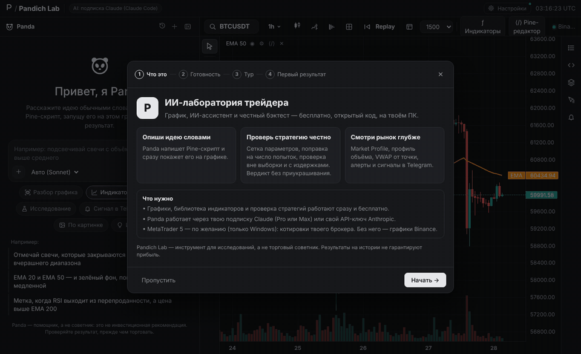

<div align="center">

# 🐼 Pandich Lab

### ИИ-лаборатория трейдера

Опиши стратегию словами — ИИ напишет Pine Script® v6, нарисует её на живом графике,<br>а честная проверка покажет, есть ли у неё перевес. Бесплатно, открытый код, на твоём ПК.

[](https://github.com/pandich93/pandich-lab/releases/latest)
[](https://github.com/pandich93/pandich-lab/stargazers)
[](LICENSE)


### [⬇ Скачать для Windows](https://github.com/pandich93/pandich-lab/releases/latest/download/PandichLab-Setup.exe) &nbsp;·&nbsp; [⬇ Скачать для macOS](https://github.com/pandich93/pandich-lab/releases/latest/download/PandichLab-mac.dmg)

[English](README.md) · **Русский** · [O'zbekcha](README.uz.md)



<sub>Тур первого запуска и честная проверка стратегии на реальных данных BTCUSDT 1h (Binance). Вердикт этого примера — «нет значимого перевеса».</sub>

</div>

⭐ **Если Pandich Lab полезен — поставь звезду репозиторию**, так его найдут другие трейдеры.

## Что нужно

| | Бесплатно, сразу | Нужно своё |
|---|---|---|
| Графики, инструменты рисования, Market Profile, профиль объёма, VWAP | ✅ | — |
| Библиотека индикаторов, Pine-редактор, тестер, **честная проверка стратегий** | ✅ | — |
| Чат **Panda** (пишет индикаторы и стратегии) | — | подписка Claude Pro/Max или API-ключ Anthropic |
| Котировки твоего брокера | — | MetaTrader 5, только Windows (без него — Binance) |

Windows 10/11 (x64) или macOS 12+. Права администратора не нужны.

## Установка за 3 шага

1. **Скачай:** [Windows — PandichLab-Setup.exe](https://github.com/pandich93/pandich-lab/releases/latest/download/PandichLab-Setup.exe) · [macOS — PandichLab-mac.dmg](https://github.com/pandich93/pandich-lab/releases/latest/download/PandichLab-mac.dmg) (Apple Silicon и Intel).
2. **Запусти.** Установщики пока не подписаны:
   - **Windows:** «Windows защитила ваш компьютер» → **Подробнее** → **Выполнить в любом случае**.
   - **macOS:** перетащи *Pandich Lab* в «Программы»; при блокировке → «Системные настройки» → «Конфиденциальность и безопасность» → **«Всё равно открыть»**. Сборка для macOS новая и проверена меньше, чем для Windows.
3. **Нажми «Установить всё»** в мастере первого запуска: он сам поставит Claude Code (на Windows ещё Git Bash и, по желанию, Python + MetaTrader5) и откроет вход в Claude. Потом короткий тур покажет, где что, и даст проверить пример стратегии.

Приложение обновляется само. Все версии — в [Releases](../../releases). Есть ИИ-агент на компьютере (Claude Code, Codex CLI, Gemini CLI, Cursor)? Скопируй в него [промпт установки](README.md#-install-with-an-ai-agent) — он сам скачает, проверит и установит релиз, спрашивая разрешение перед каждым шагом.

## Что это

Pandich Lab — приложение, которое работает у тебя на компьютере: слева чат **Panda** (Claude), справа живой график.

- **Опиши идею словами.** Panda пишет Pine Script v6, сам запускает его на текущем графике через [PineTS](https://www.npmjs.com/package/pinets), читает ошибки, исправляет и рисует результат. Готовый код можно вставить в TradingView.
- **Проверь стратегию честно, до того как рискнуть деньгами.** Не «лучшие параметры», а устойчивая область сетки и её среднее; поправка на число попыток (deflated Sharpe); walk-forward вне выборки; Монте-Карло; спред брокера по каждому бару и проскальзывание. Итог — понятный вердикт: «нет значимого перевеса», «нужна проверка» или «форвард-тест на демо».
- **Исследования.** Попроси Panda проверить несколько идей подряд — каждая пройдёт ту же честную проверку, итоги собираются в одну сводку.

Возможности:

- **График:**
  - любые таймфреймы, включая нестандартные (22m, 90m, 2D);
  - 10 типов графика, логарифмическая и процентная шкалы;
  - 38 инструментов рисования, включая профиль объёма (в диапазоне и с привязкой) и VWAP с привязкой;
  - Market Profile (TPO): POC, зона стоимости, начальный баланс, «голые» POC.
- **Мульти-график** до 8 окон с синхронизацией символа, интервала, перекрестия и времени.
- **Pine-редактор** (Monaco): подсветка, автодополнение, ошибки на строке, логи, тестер стратегий, история версий, diff.
- **Replay:** проигрывание истории бар за баром. Индикаторы на каждом шаге пересчитываются только по открытым барам. Есть бумажные сделки с SL/TP и карточка итогов: profit factor, просадка, кривая эквити, CSV.
- **Список и алерты:** котировки, ценовые алерты на пересечение уровня (линия на графике, уведомление и Telegram).
- **Watch:** сервер сам отслеживает `alert()` и `alertcondition()` на закрытии бара и шлёт уведомление в Telegram или в браузер. Работает и при закрытой вкладке.
- **История:** все чаты с Panda и отчёты проверок сохраняются — поиск, продолжить чат, выгрузка в Markdown.
- **Библиотека:** 23 встроенных индикатора и стратегии, шаблоны индикаторов, макеты экрана.
- **Данные:**
  - крипта с Binance через публичное зеркало;
  - по желанию свой счёт MetaTrader 5 (только Windows, только чтение котировок).

## Как работает ИИ

Panda работает через твой собственный Claude:

- **По умолчанию** через локальный [Claude Code](https://docs.claude.com/en/docs/claude-code/overview), вошедший в твою подписку Claude (Pro/Max). Запросы расходуют её лимиты.
- **Или** через твой API-ключ Anthropic: «⚙ Настройки» → карточка Claude → «Свой API-ключ». Ключ хранится только на твоём компьютере, оплата идёт по расходу токенов с твоего счёта Anthropic.
- Способ входа выбираешь ты сам; приложение не отключает ни один способ входа Claude Code.

Проект не включает и не раздаёт ничьих учётных данных: каждый пользователь подключает свои.

## Частые вопросы

- **Это бесплатно?** Да: графики, библиотека, тестер и честная проверка стратегий бесплатны и работают без регистрации. Платное только одно — твой собственный Claude для чата Panda (подписка Pro/Max или API-ключ). Pandich Lab не берёт за это деньги и не видит твой аккаунт.
- **Это торговый робот?** Нет. Pandich Lab ничего не покупает и не продаёт и не подключается к счёту для торговли — MetaTrader 5 используется только для чтения котировок.
- **Проверка сказала «нет значимого перевеса». Это ошибка?** Скорее всего нет: так заканчивается большинство стратегий из соцсетей. Проверка для того и нужна, чтобы узнать это на истории, а не на своём депозите.
- **Без Claude чем-то можно пользоваться?** Да, всем, кроме чата: графики, рисование, библиотека, Pine-редактор, Replay, алерты, проверка стратегий.
- **Где мои данные?** Только у тебя на компьютере. Сервер слушает 127.0.0.1 и не открыт в сеть.

## Установка из исходников

Нужно:
- [Node.js](https://nodejs.org) 18+;
- [Claude Code](https://docs.claude.com/en/docs/claude-code/overview): `npm install -g @anthropic-ai/claude-code`, затем один раз запустить `claude` и войти.

Без Claude Code график тоже работает, недоступен только чат.

**Windows:**
1. Распакуй архив и запусти `start.bat`. Он поставит зависимости и откроет http://localhost:3777.
2. Для котировок MetaTrader 5 (необязательно) нужны 64-битный Python 3 и запущенный терминал MT5. `start.bat` сам поставит пакет `MetaTrader5`.
3. Claude Code на Windows нужен Git for Windows (Git Bash).

**macOS / Linux:**
```bash
./start.sh
```
Или вручную: `npm install && npm start`. MT5 здесь недоступен (пакет `MetaTrader5` только для Windows), работают данные Binance.

## Настройка

Скопируй `config.example.json` в `config.json` и измени нужное. Поля в `server.mjs` → `CFG`:
- `backend`: `claude-code` или `api`;
- `model`;
- `claudeBin`;
- `anthropicApiKey` (для `backend: api`);
- `python`, `mt5Path`, `mt5Enabled`.

Переменные окружения:

| Переменная | Назначение |
|---|---|
| `PORT` | порт сервера, по умолчанию 3777 |
| `QL_PYTHON` | команда Python для моста MT5 |
| `MT5_PATH` | путь к `terminal64.exe`, если терминалов несколько |
| `MT5=0` | отключить MT5 |
| `MOCK=1` | синтетические данные для разработки |

Личные данные хранятся только у тебя и в git не попадают (`.gitignore`):
- `data/`: сигналы Watch, настройки Telegram, шаблоны, макеты;
- `scripts/`: сохранённые скрипты.

## Язык интерфейса

Русский, O'zbekcha и English. Язык выбирается в мастере первого запуска или в «⚙ Настройки» → «Приложение». Panda отвечает на языке интерфейса.

## Если что-то не подключается

Нажмите **⚙ Настройки** в правом верхнем углу. Там видно состояние Claude Code (Panda), MetaTrader 5, Binance, интернета и Telegram. Для каждой проблемы написано, что сделать, и есть кнопки: «Проверить Panda», «Войти в Claude», «Установить Claude Code», «Переподключить MT5», «Установить модуль». Точка на кнопке настроек показывает общее состояние: зелёная — всё в порядке, жёлтая — предупреждение, красная — проблема.

Не получается — нажмите **«Скопировать диагностику»** и пришлите текст в [Issues](https://github.com/pandich93/pandich-lab/issues). Путь к домашней папке, имя пользователя, токены и номер счёта в отчёте скрываются.

## Безопасность

- Сервер слушает только `127.0.0.1`. **Не открывай его в сеть и не выставляй в интернет:** в нём нет авторизации.
- Panda запускается в Claude Code с разрешением читать и писать файлы в папке `agent/` и выполнять `node ql.mjs …`, без подтверждения каждого шага (`--permission-mode dontAsk`). Pine-код выполняется в процессе сервера.
- Запускай только код, которому доверяешь.

## Отказ от ответственности

Это инструмент для исследования и обучения, а **не инвестиционная рекомендация**. Индикаторы, сигналы, Replay и бэктесты могут ошибаться. Торговля на финансовых рынках связана с риском потери средств. Авторы не несут ответственности за твои торговые решения.


## Лицензия

Pandich Lab распространяется по лицензии **GNU AGPL v3.0** — см. [LICENSE](LICENSE); сторонние компоненты — в [NOTICE](NOTICE). Независимый проект, не связан с TradingView, Anthropic и MetaQuotes. Подробнее — в [README на английском](README.md#license).
