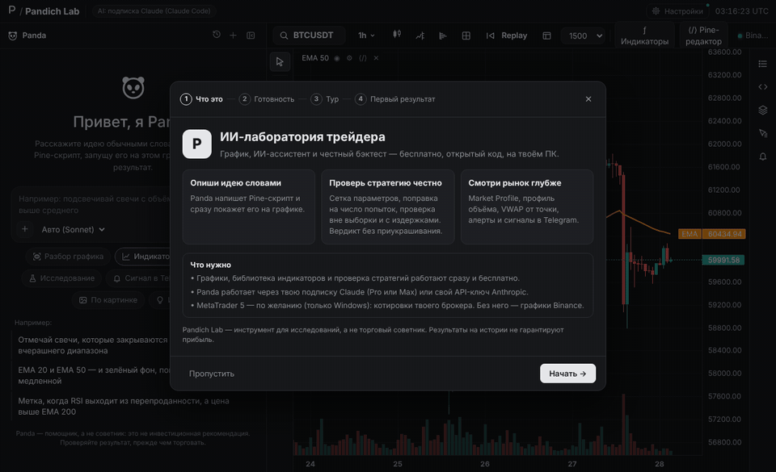

# 🐼 Pandich Lab

### Treyder uchun AI laboratoriya

Strategiyani so'z bilan tasvirlang — AI Pine Script® v6 kodini yozadi, uni jonli grafikda chizadi, halol tekshiruv esa unda haqiqiy ustunlik bor-yo'qligini ko'rsatadi. Bepul, ochiq kod, o'z kompyuteringizda.

### [⬇ Windows uchun yuklab olish](https://github.com/pandich93/pandich-lab/releases/latest/download/PandichLab-Setup.exe) &nbsp;·&nbsp; [⬇ macOS uchun yuklab olish](https://github.com/pandich93/pandich-lab/releases/latest/download/PandichLab-mac.dmg)

[English](README.md) · [Русский](README.ru.md) · **O'zbekcha**

⭐ **Pandich Lab foydali bo'lsa, repozitoriyga yulduzcha qo'ying** — boshqa treyderlar ham topsin.

## Bu nima

Pandich Lab — kompyuteringizda ishlaydigan dastur: o'ngda jonli grafik, chapda **Panda** ismli AI yordamchi.

- **G'oyani so'z bilan tasvirlang.** Panda Pine Script v6 kodini yozadi, grafikda ishga tushiradi, xatolarni tuzatadi va natijani chizadi. Tayyor kodni TradingView'ga qo'yishingiz mumkin.
- **Strategiyani pul tavakkal qilishdan oldin halol tekshiring.** «Eng yaxshi parametrlar» emas, balki parametrlar to'rining barqaror hududi va uning o'rtachasi; urinishlar soniga tuzatish; tanlamadan tashqari walk-forward; Monte-Karlo; brokerning har bir shamdagi spredi. Natija — tushunarli xulosa.

Imkoniyatlar:

- **Grafik:** istalgan taymfreym (22m, 90m, 2D ham), 10 xil grafik turi, 38 ta chizish asbobi (hajm profili va VWAP ham), Market Profile.
- **Multi-grafik:** bir ekranda 8 tagacha grafik, sinxronlashtirish bilan.
- **Pine-muharrir:** kod yozish, xatolar, loglar, strategiya testeri, versiyalar tarixi.
- **Replay:** tarixni sham-shamlab qayta o'ynatish va qog'ozda savdo qilish.
- **Ro'yxat va alertlar, Watch:** narx alertlari va signallar Telegram'ga, oyna yopiq bo'lsa ham.
- **Tarix:** Panda bilan barcha chatlar va tekshiruv hisobotlari saqlanadi.
- **Kutubxona:** 23 ta tayyor indikator va strategiya, shablonlar, ekran maketlari.
- **Ma'lumotlar:** Binance (kripto) va, xohlasangiz, o'z MetaTrader 5 hisobingiz (faqat Windows).

## O'rnatish

1. Faylni yuklab oling: **Windows** — [PandichLab-Setup.exe](https://github.com/pandich93/pandich-lab/releases/latest/download/PandichLab-Setup.exe), **macOS** — [PandichLab-mac.dmg](https://github.com/pandich93/pandich-lab/releases/latest/download/PandichLab-mac.dmg).
2. Ishga tushiring.
   - **Windows** ogohlantirsa: **Подробнее / More info** → **Выполнить в любом случае / Run anyway**.
   - **macOS** bloklasa: System Settings → Privacy & Security → **Open Anyway**.
3. Birinchi ishga tushirishda **«Установить всё»** tugmasini bosing: dastur kerakli hamma narsani o'zi o'rnatadi (Windows: Claude Code, Git Bash, xohlasangiz Python + MetaTrader5; Mac: Claude Code). Keyin brauzerda Claude akkauntingizga kiring. Qisqa sayohat nima qayerdaligini ko'rsatadi va namuna strategiyani tekshirib ko'rishni taklif qiladi.

Yoki AI-agentingiz bo'lsa, [o'rnatish promptini](README.md#-install-with-an-ai-agent) unga nusxalang — o'zi o'rnatib beradi.

## AI qanday ishlaydi

Panda sizning o'z **Claude** obunangiz (Pro/Max) yoki API kalitingiz orqali, kompyuteringizdagi Claude Code yordamida ishlaydi. Chatdan boshqa hamma narsa — grafiklar, kutubxona, strategiyalarni tekshirish — obunasiz va bepul ishlaydi. Pandich Lab savdo roboti emas: hech qanday buyurtma bermaydi.

## Interfeys tili

Ruscha, O'zbekcha va English. Tilni birinchi ishga tushirishdagi sozlash ustasida yoki «⚙ Sozlamalar» → «Ilova» bo'limida tanlang. Panda interfeys tilida javob beradi.

## Ulanish bilan muammo bo'lsa

O'ng yuqoridagi **⚙ Настройки** tugmasini bosing: Claude Code (Panda), MetaTrader 5, Binance, internet va Telegram holati ko'rinadi. Har bir muammo uchun nima qilish kerakligi yozilgan va tuzatish tugmalari bor. Hal bo'lmasa, **«Скопировать диагностику»** tugmasini bosib, matnni dasturchiga yuboring.

## Ogohlantirish

Bu o'rganish va tahlil uchun vosita, **investitsiya maslahati emas**. Moliyaviy bozorlarda savdo qilish pul yo'qotish xavfi bilan bog'liq.

## Litsenziya

Pandich Lab **GNU AGPL v3.0** litsenziyasi ostida tarqatiladi — [LICENSE](LICENSE); uchinchi tomon komponentlari — [NOTICE](NOTICE). Mustaqil loyiha, TradingView, Anthropic va MetaQuotes bilan bog'liq emas. Batafsil — [inglizcha README](README.md#license).
